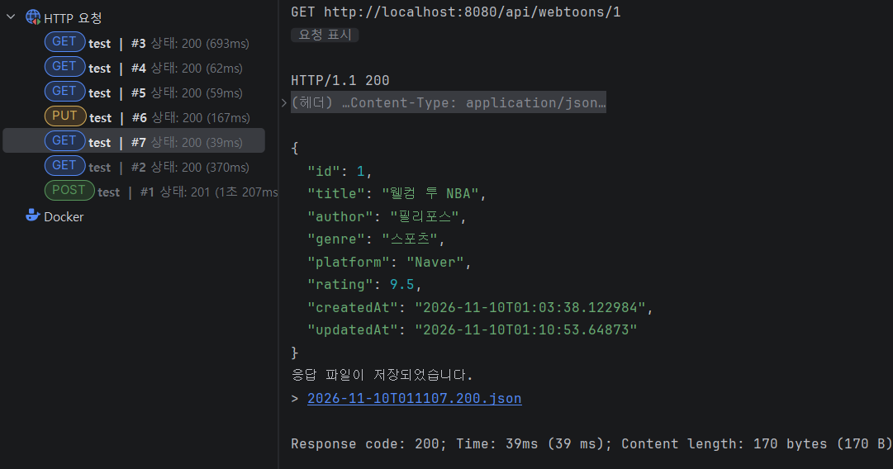
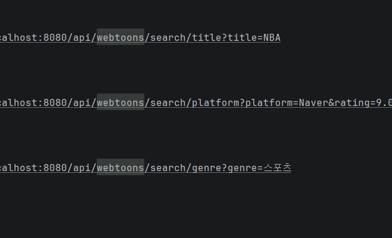
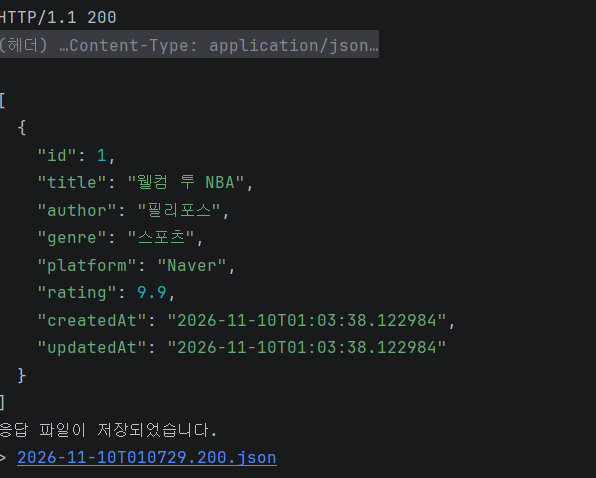
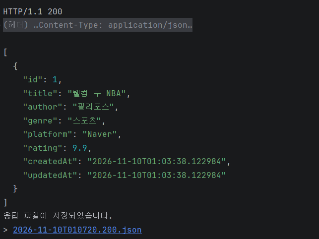
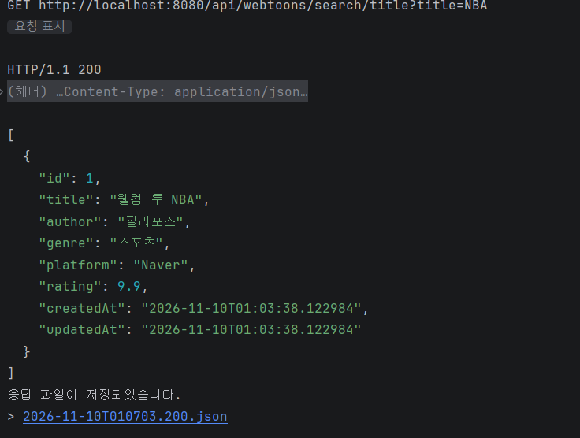
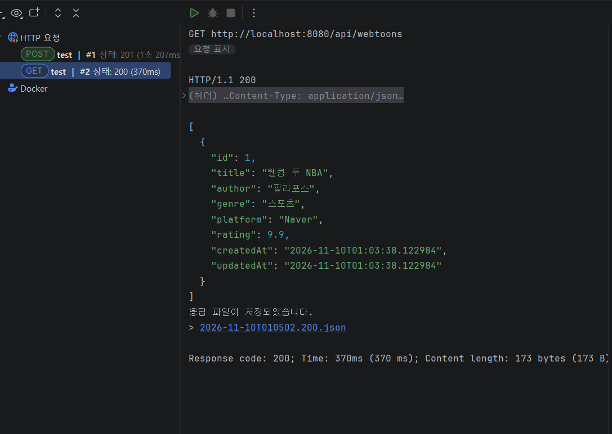
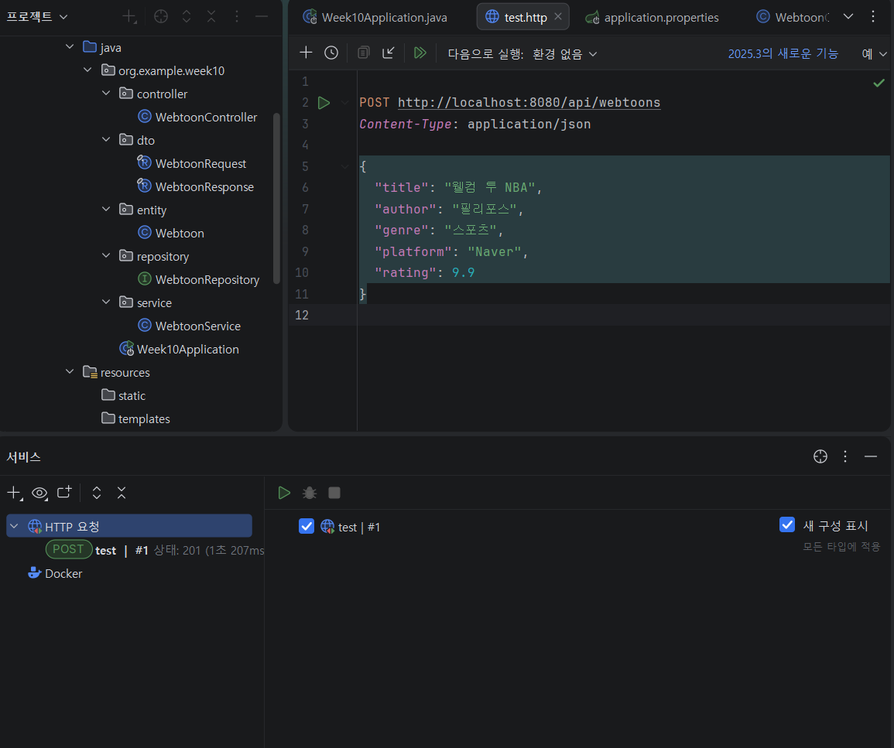

1. 프로젝트 소개

- 웹툰 관리 프로그램
- 등록, 조회, 수정, 삭제 및 검색
- GitHub: https://github.com/6heang-maker/week10-web
- Render: https://week10-web-b7s9.onrender.com/api/webtoons

2. 주요 구현 내용

- Query Method
    - findByTitleContaining: 제목 검색
    - findByPlatformAndRatingGreaterThanEqual: 플랫폼과 평점 검색
    - findByGenreOrderByRatingDesc: 장르별 평점순 정렬

- Dirty Checking
    - Transactional을 사용하여 save() 없이 데이터 수정

- Auditing
    - CreatedDate와 LastModifiedDate를 이용해 생성 및 수정 시간 자동 기록

- 실행 결과

3. Weekly Review

- Key Learning
    - 모든 것. 당장 이번 수업에서 TA님께 주수를 연결하는 걸 나머지 과정으로 배웠다. 연결부터 모든 걸 배웠다.
    - 코드를 만드는 것, 테스트 하는 것, 모두 그냥 계속 배우고 있다. 

- Problem & Solution
   - 모든 과정이 모든 행동이 너무 어렵고 어려웠다. 문제가 없었던 부분은 내가 언젠가 문제로 마주하여 경험한 
   부분 뿐이다. 공백이 잠깐 있어서 그런지 너무 어려웠다. ai와 선배가 아니었으면 지금 이 늦게 제출하지도 못했을 거다.
   - 시간을 들이고 머리가 아프면 대부분의 문제는 언젠가 해결이 된다. 
   - postman이 이유를 알 수 없게 아예 열리지가 않았다. 다시 설치해야될 것 같아서 ai를 이용해서 인텔리제이 안에서 실행해봤다.

- Reflection
    - 공부를 시급히 해야겠다. 내가 스스로 사용하기 위해 근래에 웹소설 정보를 저장하고 마음에 들었던 부분을 저장하는 앱을
Ai를 이용해서 만들었다. 그래서 웹툰으로 주제를 선정했는데 직접 전부 하려니까 많이 배워야겠더라.
    - 수정한 시간이나 데이터를 등록하면 시간이 자동으로 저장되는 것도 알았다.
    - 특정 조건으로 검색하는 방법도 알았다. 

4. AI Usage

- 처음에 코드를 짜면서 만드는 것을 제외하고 진짜 사용하지 않은 부분이 더 적다. 매 부분에서 막히고 오류가 나고 나는 틀렸다.
- 해결하는 방법은 초반에 같이 있던 선배를 제외하고 AI밖에 없어서 많은 도움을 받앗다. 
- AI 퍼센트: 60퍼센트 정도 사용한 것 같다. 내가 배웠던, 내가 했던 과제에 포함되고 기억이 나는 부분들은 내가 했다. 
- 말한 거에 비해 사용률이 낫을 수 있는데 내가 그냥 바로 AI의 도움을 받은 게 아니라 아프게 부딪쳐보고 사용했다. 